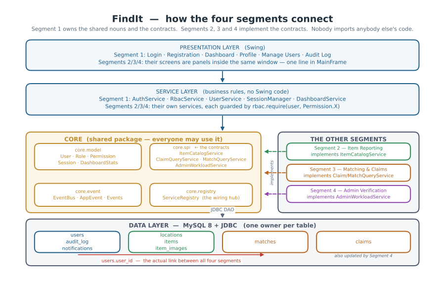

# FindIt — Campus Lost & Found Management System

[](https://github.com/nmerror/Findit/actions/workflows/ci.yml)
[](https://nmerror.github.io/Findit)

**FindIt – Campus Lost & Found Management System**
Segment 1: *User Authentication, Role-Based Access Control & Dashboard Management* — plus the first
working lost-and-found flow: **post a lost item with a photo, close it when it is found, let the
office remove it.**

> **There is no fake data in this project.** The dashboard starts at zero, the board is empty and
> every row you see was really written into MySQL by a user through the application. The demo data
> generator that used to sit in `tools/` has been deleted on purpose.

---

## 1. Run it right now (no database needed)

**The fastest way — one command, on any machine with JDK 17:**

| Windows | macOS / Linux |
|---|---|
| double-click **`run.bat`** | **`bash run.sh`** |

The script compiles the project and opens the application. Nothing else is
needed — no Maven, no MySQL.

**No Java installed yet?** Let the project bring its own:

| Windows | macOS / Linux |
|---|---|
| double-click **`setup-java.bat`** | **`bash setup-java.sh`** |

That downloads the official Eclipse Temurin JDK 17 into the project folder
(`.jdk/`, about 320 MB) and the launcher uses it automatically. Nothing is
installed system-wide, no administrator rights are needed and your `PATH` is
left untouched — delete the `.jdk` folder to remove it completely.

```bash
bash setup-java.sh   # once
bash run.sh          # every time
```

> On macOS / Linux, if `./run.sh` says *Permission denied*, either run
> `bash run.sh` or make it executable once with `chmod +x run.sh`.

**Or by hand:**

```bash
cd findit
mvn -q compile
java -cp target/classes com.bubt.findit.Main --memory
```

| Flag | Effect |
|---|---|
| `--memory` | runs everything in RAM, no database server needed |
| `--mysql` | runs against the real MySQL database (`app.properties`) |

**Logins**

| Role | E-mail | Password |
|---|---|---|
| ADMIN | `admin@findit.edu` | `Admin@1234` |
| STUDENT | `ayesha@buet.edu` | `Student@123` |
| STUDENT | `tanvir@buet.edu` | `Student@123` |

You can also **create your own account** in two seconds — the registration screen
only asks for a name, an ordinary e-mail address (for example `user234@gmail.com`),
a password and — optionally — a student ID. If you leave the student ID empty,
the system generates one for you.

---

## 2. The screens

### The entry screens — black, white and grey

| Screen | File | What it does |
|---|---|---|
| Sign in | `ui/auth/LoginFrame.java` | dark card, e-mail **or** student ID, links to register and to the reset |
| Create an account | `ui/auth/RegisterFrame.java` | dark, normal e-mail, optional student ID |
| Forgot the password | `ui/auth/ForgotPasswordFrame.java` | dark, two steps: e-mail → **6-digit PIN** → new password |

The three entry screens are the only dark ones. They use black, white and grey
only — see `ui/auth/AuthColors.java`.

### The application — one light theme

| Screen | File | What it shows |
|---|---|---|
| Dashboard | `ui/dashboard/DashboardPanel.java` | 4 KPI cards, the recent lost posts with photo thumbnails, the accounts |
| Post a lost item | `ui/posts/PostLostItemPanel.java` | title, **category drop-down**, brand, colour, place, description, **photo** |
| My Posts | `ui/posts/MyPostsPanel.java` | the posts of the signed-in student + **Confirm found** |
| Manage Accounts (admin) | `ui/users/UserManagementPanel.java` | every account + **Delete account** |
| Manage Posts (admin) | `ui/posts/PostManagementPanel.java` | every post of the campus + **Remove the post** |
| My Profile / Search / Reports / Audit Log | `ui/users/ProfilePanel.java`, `ui/search/…`, `ui/reports/…`, `ui/users/AuditLogPanel.java` | profile, global search, export, audit trail |

> PNG screenshots of every screen live in `docs/images/`. They are not
> committed here because the GitHub API used for this upload is text-only.
> Regenerate any of them with:
> `java -cp target/classes com.bubt.findit.tools.Screenshot dashboard out.png`

---

## 3. How the lost-and-found flow works

Three rules, and they live in **one small file** — `service/PostService.java`:

1. **A student posts a lost item.** Title, category (*electronic, documents, accessories,
   clothing, keys, books, other*), brand, colour, the place on campus, a description and
   **a photo**. The picture is copied into `uploads/` and its path is stored in
   `item_images`; the board shows it as a small thumbnail.
2. **The owner clicks “Confirm found”.** The post gets the status `CLOSED` and disappears
   from the open board — the row stays in the database for the audit trail.
3. **The administrator can remove a post at any time** with “Remove the post” — a real
   `DELETE`.

### Who sees what

| | Student | Administrator |
|---|---|---|
| Dashboard | lost posts, own posts, **only student accounts** | everything, **all accounts** |
| Post a lost item / My Posts | yes | — |
| Manage Accounts / Manage Posts / Audit Log | — | yes |

The administrator account is **never** listed in the student panel — `UserService.visibleAccounts()`
filters by role, and the test suite proves it.

### Forgot the password — the PIN

1. The student writes their e-mail on the *Forgot your password* screen.
2. The system creates a **6-digit PIN** (`SecureRandom`), stores it in the table
   `password_resets` with a 10-minute expiry and shows it on the screen (and prints it
   in the console — the project has no mail server yet).
3. The student writes the PIN and the new password. The PIN is used once and then
   marked as used.
4. The old password stops working, the new one works.

A wrong PIN is refused, a used PIN is refused, and an expired PIN is refused.

---

## 4. The interface — one light theme, flat and plain

The application uses **one** light theme and **flat** surfaces: no gradients,
no glows, no dark mode, no custom title bar. The window keeps the decorations
of the operating system, so it behaves like every other program on the
machine. Only the three entry screens (sign in / register / reset) are dark,
because black, white and grey make the first contact look calm and serious.

The look-and-feel is **Nimbus** (part of every JDK) and the colours of the
standard Swing widgets are set in `ui/common/UiTheme.java`, so tables, scroll
bars and text fields look native.

---

## 5. The interface — a small design system

The cards, buttons, inputs and charts are painted by hand, so the project
looks the same on every machine.

| Component | What it gives you |
|---|---|
| `UiTheme` | Every colour, radius and font in one file (white surfaces + teal/violet accents) |
| `AuthColors` | The black / white / grey palette of the entry screens |
| `Fonts` | Uses the system interface font, falls back to the Java logical font |
| `BaseFrame` | Base class of every window: title, size and the panel for the content |
| `RoundedPanel` | Cards with rounded corners, flat fill and a hairline border |
| `AppButton` | Primary / secondary / danger / quiet buttons with a hover state |
| `ModernTextField` | Flat input with a thin border, an accent focus border and a placeholder |
| `FlatComboBox` | Flat drop-down with a chevron — used for the category and the place |
| `PhotoRenderer` | Draws the thumbnail of a lost item in a table cell (and caches it) |
| `EmptyState` | The friendly "nothing here yet" message of an empty table |
| `NavButton` | Sidebar item with vector glyph and an accent bar when active |
| `StatCard` | KPI card — caption, big number, glyph badge |
| `StackedBar` / `BarList` | Charts drawn with Graphics2D (no charting library) |
| `StatusBadge` / `StatusTableRenderer` | Coloured status pills, also inside tables |
| `Icons` | 14 vector glyphs drawn in code — the project ships **no image files** |
| `ModernTable` | Light tables: soft stripes, styled header, fixed column widths |
| `StretchPanel` | Makes content fill the width of a scroll pane (no stray scrollbars) |

Your teammates should build their screens with **these** components instead of
inventing their own colours — that is how the four segments end up looking
like one product.

---

## 6. Run it with MySQL (what the proposal asks for)

**Step 1 — create the database.** The schema has the **whole project** in it:
nine tables with foreign keys, indexes and constraints.

```bash
mysql -u root -p < sql/01_schema.sql
mysql -u root -p < sql/02_seed_data.sql
```

**Step 2 — set your credentials.** Put an `app.properties` next to the project
(it is not committed to GitHub):

```properties
app.mode   = mysql
db.url     = jdbc:mysql://localhost:3306/findit?useSSL=false&serverTimezone=UTC&allowPublicKeyRetrieval=true
db.user    = root
db.password = yourPassword
db.pool.size = 8
```

**Step 3 — run it.**

```bash
bash run.sh --mysql
```

The launcher puts the MySQL driver (from `lib/`) on the classpath for you.
With a database attached the dashboard, the board, the report and the search read
the **real tables**.

### What the seed file contains — and what it does not

`sql/02_seed_data.sql` loads **three accounts and the six places of the campus**. It loads
**no lost items** — the board starts empty, exactly like it does on a fresh installation.
Every post you see in the application was written by a user through the application.

The passwords are hashed with `PBKDF2WithHmacSHA256` (120,000 rounds, a random salt per
account). To build a hash for a new password run:

```bash
java -cp target/classes com.bubt.findit.tools.HashTool MySecret123
```

---

## 7. Verify the logic

**Without a GUI and without a database** (43 checks):

```bash
java -cp target/classes:target/test-classes com.bubt.findit.SelfTest
```

**43 checks**: registration validation, login (e-mail *and* student ID),
suspension, RBAC, session expiry, the event bus, the global search, the report
builder, and — the important one — the dashboard and the search picking up a
fake Segment 2 implementation **through the contract, with no change in
Segment 1's code**.

**Against the real database** (67 checks — users, audit trail, notifications,
items, matches, claims, the contracts, transactions, the connection pool **and the
complete lost-and-found flow**):

```bash
java -cp "target/classes:target/test-classes:lib/*" com.bubt.findit.BackendSelfTest
```

The database test walks through the whole story of the application:

```
register with user234@gmail.com  →  the student ID is generated
request a reset                  →  a 6-digit PIN arrives
wrong PIN                        →  refused
right PIN + new password         →  the password is changed
old password                     →  no longer works
the same PIN again               →  refused
post a lost item                 →  it is on the board
confirm found                    →  it disappears from the board
the administrator removes a post  →  it is gone for good
the administrator deletes an account →  it is gone for good
a student never sees the manager  →  proven
```

Run the second one after every change in `db/` — it is the test that catches
the mistakes the in-memory mode hides.

---

## 8. Project layout



```
findit/
├── pom.xml
├── .github/workflows/
│   ├── ci.yml                  ← the automatic build: compile + 43 + 67 tests
│   └── pages.yml               ← the project page with the screenshots
├── sql/
│   ├── 01_schema.sql          ← database contract for all 4 segments (9 tables)
│   └── 02_seed_data.sql       ← 3 accounts + 6 campus locations, no fake posts
├── docs/
│   ├── START_HERE.md           ← your day-by-day plan
│   ├── PROJECT_DESCRIPTION.md  ← the full description of the project
│   ├── PRESENTATION_SCRIPT.md  ← who presents which part
│   ├── SEGMENT1_DESIGN.md      ← how Segment 1 is designed
│   ├── SEGMENT1_FILE_INDEX.md  ← every file, and who owns it
│   ├── INTEGRATION_CONTRACT.md ← what your teammates must implement
│   ├── site/                   ← the project page (GitHub Pages)
│   └── images/
└── src/main/java/com/bubt/findit/
    ├── core/                   ← SHARED CODE — everybody may use it
    │   ├── model/              ← User, Role, Permission, Session, ItemSummary…
    │   ├── spi/                ← SERVICE CONTRACTS (implemented by Segments 2/3/4)
    │   │   └── stub/           ← temporary placeholders so the app always runs
    │   ├── event/              ← EventBus, AppEvent, Events
    │   ├── registry/           ← ServiceRegistry (the wiring hub)
    │   ├── util/               ← PasswordHasher, Validation
    │   └── AuthContext.java    ← "who is using the app right now"
    ├── db/                     ← the JDBC layer, one DAO per table
    │   └── dao/
    ├── service/                ← business rules (Segment 1)
    │   └── PostService.java    ← the three rules of the lost-and-found flow
    ├── ui/                     ← Swing screens (Segment 1)
    │   ├── auth/               ← login, register, forgot password (dark)
    │   ├── posts/              ← post, my posts, manage posts
    │   ├── dashboard/  users/  search/  reports/  common/
    ├── app/AppServices.java    ← dependency container
    ├── config/AppConfig.java
    └── Main.java
```

---

## 9. The automatic build and the project page

**Every push and every pull request is built and tested by GitHub itself**
(`.github/workflows/ci.yml`). The build server

1. compiles the source files with JDK 17,
2. starts a real **MySQL 8** in a container and loads `sql/01_schema.sql` and `sql/02_seed_data.sql`,
3. runs the **43** unit tests,
4. runs the **67** database tests against that MySQL server,
5. starts the application on a virtual screen and takes a screenshot of every screen.

The green tick on the pull request is the proof that the code works — for the teacher and for the
team.

**The project page** (`.github/workflows/pages.yml`) publishes those screenshots together with the
description of the project on

> **https://nmerror.github.io/Findit**

To switch it on (once, by the repository owner): *Settings → Pages → Build and deployment →
Source: **GitHub Actions***.

> The two workflow files are in this repository as a reference copy under
> [`docs/workflows/`](docs/workflows/ACTIVATION.md) — the GitHub connection that pushed
> this repository is not allowed to write into `.github/workflows/`. The activation guide
> shows how to copy them there in two minutes.

---

## 10. The four rules that keep the team out of merge conflicts

1. **A segment only writes its own tables.** Segment 1 owns `users`, `password_resets` and
   `audit_log`; Segment 2 owns `locations`, `items`, `item_images`; Segment 3
   owns `matches`, `claims`; Segment 4 writes only `claims` and `audit_log`.
   Everything else is read through a foreign key.

2. **Segment 1 never imports a class from Segment 2, 3 or 4.** It only uses the
   interfaces in `core.spi`. Their implementations arrive at run time through
   `ServiceRegistry`. This is what makes the merge painless.

3. **Nobody calls `AuthContext.currentUser()` → then asks "who is this?"
   again.** `AuthContext` is the single source of the current user.

4. **Permission checks live in the service layer, not in the button handler.**
   `rbac.require(user, Permission.APPROVE_CLAIM)` — the UI is not a security
   boundary.

---

## 11. Where to start (full plan in `docs/START_HERE.md`)

| Step | What you build | Why it is first |
|---|---|---|
| 1 | `sql/01_schema.sql` + `core/model` | Everyone codes against the same data model |
| 2 | `db/dao` + `config/AppConfig` | Data access behind an interface |
| 3 | `service/AuthService` + `SessionManager` | The core of Segment 1 |
| 4 | `service/RbacService` + `Permission` | Decides what each role may do |
| 5 | `core/spi` + `core/event` + `ServiceRegistry` | **The integration layer** |
| 6 | `ui/auth` + `ui/MainFrame` + `ui/dashboard` | The screens |
| 7 | `docs/INTEGRATION_CONTRACT.md` + team meeting | Hand the contracts to the team |

> **Do step 5 early.** The moment your teammates can code against your
> interfaces, you stop being the bottleneck for the rest of the project.
